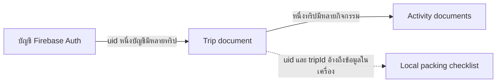

# ออกแบบฐานข้อมูล TripPocket

สถานะ: แบบออกแบบสำหรับ MVP ยังไม่ได้สร้างฐานข้อมูลจริงหรือ deploy Rules วันที่ออกแบบ 20 ตุลาคม 2569 ใช้ Flutter เชื่อม Cloud Firestore โดยตรงตามสถาปัตยกรรมที่เลือก

## 1 ข้อมูลอยู่ที่ไหน

การ [แชร์แผนเที่ยวเป็นข้อความ](FEATURE_SHARE_PLAN.md) สร้างข้อความใน Flutter จากทริปและกิจกรรมที่โหลดแล้ว ไม่มีข้อมูลแชร์ที่ต้อง persist และไม่เพิ่ม sharing collection หรือ public-read Rules

| ข้อมูล | ที่เก็บ | เหตุผล |
|---|---|---|
| บัญชี อีเมล และ session | Firebase Authentication | ให้บริการสมาชิกจัดการรหัสผ่าน |
| ทริป | Cloud Firestore | CRUD และเปิดข้อมูลของบัญชีเดิมได้ |
| กิจกรรมในทริป | Cloud Firestore subcollection | แก้ไขแต่ละกิจกรรมได้แยกจากทริป |
| เช็กลิสต์เตรียมของ | SharedPreferences ในเครื่อง | ใช้เตรียมของได้แม้ไม่มีอินเทอร์เน็ต |
| ยอดวางแผนและเงินคงเหลือ | คำนวณใน Flutter | ไม่เก็บยอดซ้ำจนคลาดเคลื่อน |

ไม่สร้าง collection สำหรับรหัสผ่าน ไม่คัดลอก email ลงทุกทริป และไม่เพิ่ม users profile document ใน MVP เพราะยังไม่มีฟอร์มแก้โปรไฟล์ หากเพิ่มภายหลังต้องกำหนดสิทธิ์และ workflow ของข้อมูลนั้นก่อน

## 2 โครงสร้าง Collections และความสัมพันธ์

```text
Firebase Authentication
  account uid = user_A

Cloud Firestore
  users/                                  collection namespace
    {uid}/                                ไม่จำเป็นต้องมี document fields
      trips/
        {tripId}/                         Trip document
          title
          destination
          startDate
          endDate
          budgetSatang
          status
          createdAt
          updatedAt
          activities/
            {activityId}/                 Activity document
              title
              date
              timeMinutes
              estimatedCostSatang
              latitude
              longitude
              note
              createdAt
              updatedAt

Local Storage
  packing.v1.{uid}.{tripId}                JSON เช็กลิสต์
  packingCleanup.v1.{uid}                  JSON tripIds ที่รอล้าง local key
```



ใช้ subcollection แทนการฝังกิจกรรมทั้งหมดเป็น array ใน Trip เพื่อ CRUD รายการแยกกันและทำ stream ได้ ไม่สร้าง days collection เพราะ date ใน Activity ใช้จัดกลุ่มวันได้อยู่แล้ว ไม่สร้าง places collection เพราะสถานที่ใน MVP เป็นหมุดที่ผูกกับกิจกรรม ไม่ใช่คลังสถานที่ส่วนกลาง

uid ใช้ค่าจาก Firebase Auth เท่านั้น tripId/activityId ใช้ Firestore auto ID และอ้าง ID จาก document snapshot ไม่เก็บสำเนา uid/tripId/activityId ใน fields

## 3 Data Dictionary ของ Trip

Path: `users/{uid}/trips/{tripId}` ทุก field ในตารางเป็น required และห้าม null

| Field | Firestore type | ตัวอย่าง | Validation / ผู้กำหนด |
|---|---|---|---|
| title | string | เชียงใหม่ 3 วัน 2 คืน | trim แล้ว 1–100 ตัวอักษร |
| destination | string | เชียงใหม่ | trim แล้ว 1–100 ตัวอักษร |
| startDate | string | 2026-11-06 | วันที่จริง YYYY-MM-DD ปี ค.ศ. |
| endDate | string | 2026-11-08 | รูปแบบเดียวกัน และ >= startDate |
| budgetSatang | integer | 300000 | จำนวนเต็ม 0–1,000,000,000 สตางค์ |
| status | string | active | enum active/deleting ตาม workflow |
| createdAt | timestamp | server timestamp | สร้างครั้งแรกแล้วแก้ไม่ได้ |
| updatedAt | timestamp | server timestamp | เปลี่ยนเมื่อแก้ fields ของ Trip |

เพดานเงิน 1,000,000,000 สตางค์เท่ากับ 10,000,000 บาท ใช้เพดานนี้ร่วมกันในฟอร์มและ Rules อนุญาตงบ 0 เพื่อเริ่มวางแผนโดยยังไม่ตั้งงบ ไม่แปลงเป็น null และไม่ตีความว่าเป็นงบไม่จำกัด

Trip.updatedAt เป็นเวลาปรับข้อมูลทริปเท่านั้น การแก้ Activity ไม่อัปเดต field นี้ใน MVP จึงไม่ใช้ field นี้อ้างว่าเป็นเวลาที่กิจกรรมใด ๆ เปลี่ยนล่าสุด

สถานะ upcoming/ongoing/past สำหรับการแสดงผลคำนวณจากช่วงวันกับวันที่ปัจจุบัน ไม่บันทึกเป็น fields เพิ่ม status ในฐานข้อมูลใช้สำหรับกระบวนการลบเท่านั้น

## 4 Data Dictionary ของ Activity

Path: `users/{uid}/trips/{tripId}/activities/{activityId}` ทุก field required ห้าม null โดย note อนุญาตข้อความว่าง

| Field | Firestore type | ตัวอย่าง | Validation |
|---|---|---|---|
| title | string | แวะคาเฟ่ | trim แล้ว 1–100 ตัวอักษร |
| date | string | 2026-11-07 | วันที่จริง และอยู่ในช่วงวัน Trip |
| timeMinutes | integer | 540 | 0–1439; 540 คือ 09:00 |
| estimatedCostSatang | integer | 20000 | 0–1,000,000,000; 20000 คือ 200 บาท |
| latitude | number | 18.7883 | finite อยู่ระหว่าง -90 และ 90 |
| longitude | number | 98.9853 | finite อยู่ระหว่าง -180 และ 180 |
| note | string | งบเครื่องดื่มและขนม | ว่างได้ ไม่เกิน 500 ตัวอักษร |
| createdAt | timestamp | server timestamp | แก้ไม่ได้หลังสร้าง |
| updatedAt | timestamp | server timestamp | เปลี่ยนเมื่อแก้กิจกรรม |

ไม่ใช้ GeoPoint ใน schema นี้ เพื่อให้ latitude/longitude ตรงกับ model และ map picker ที่ตกลงไว้ ไม่มี geospatial search ใน MVP ไม่เก็บชื่อสถานที่ที่ reverse-geocode อัตโนมัติ title และ note เป็นข้อมูลที่ผู้ใช้กรอก

พิกัด 0 เป็นค่าที่ถูกต้อง จึงต้องแยกกรณีไม่มีพิกัดออกจาก 0 ห้ามใส่ (0,0) เป็น default แทนการยืนยันของผู้ใช้ พิกัดเริ่มต้นบนแผนที่มีไว้จัดกล้องเท่านั้น

ไม่มีสถานะเสร็จแล้วหรือการเช็กอินกิจกรรมใน MVP เพราะยังไม่ใช่ฟีเจอร์ที่ตกลงกัน ไม่ต้องเพิ่ม fields เผื่อใช้งานโดยไม่มีหน้าจอรองรับ

## 5 วันที่ เวลา เงิน และ timestamps

- วันที่เก็บ YYYY-MM-DD แบบเติมศูนย์ เช่น 2026-01-09 ไม่ใช่ 2026-1-9 ใช้ Dart ตรวจวันที่จริงก่อนบันทึก และ Rules ตรวจรูปแบบและลำดับวัน
- วันเดินทางและเวลาเป็นค่าท้องถิ่นตามที่ผู้ใช้กรอก การเปลี่ยน timezone ของเครื่องต้องไม่เปลี่ยนวันทริป ไม่ใช้ UTC Timestamp สำหรับ date-only fields
- เวลาเก็บนาทีตั้งแต่เที่ยงคืนและแปลงเป็น HH:mm ตอนแสดงผล อนุญาตกิจกรรมเวลาเดียวกัน โดยเรียง ID เป็นตัวตัดสิน
- เงินเก็บจำนวนเต็มสตางค์ แปลงจากข้อความด้วยการแยกบาท/เศษสตางค์ ไม่ใช้ double × 100 เป็นวิธีหลัก
- createdAt/updatedAt เขียนด้วย FieldValue.serverTimestamp() ไม่ใช้เวลาจากเครื่องเป็นแหล่งอ้างอิง
- ช่วง snapshot ที่ server timestamp ยัง pending ให้ model/UI รองรับค่ารอ server ไม่ crash หรือใช้เวลา 1970 เป็นค่าจริง

Rules และ Dart อาจนับ Unicode ต่างกัน ต้องทดสอบข้อความภาษาไทย สระ/วรรณยุกต์ และ emoji ที่ขอบความยาว ให้ client ไม่รับค่าที่ Rules จะปฏิเสธเงียบ ๆ

## 6 ตัวอย่างข้อมูลสำหรับสาธิต

ตัวอย่างเหล่านี้เป็น JSON สำหรับอธิบายข้อมูล ไม่ใช่ Firestore export format ข้อความ ISO ใน createdAt/updatedAt ต้องแปลงเป็น Firestore Timestamp ตอน seed จริง และใช้ serverTimestamp สำหรับการสร้างผ่านแอป

Trip ที่ `users/user_A/trips/demo_trip`:

```json
{
  "title": "เชียงใหม่ 3 วัน 2 คืน",
  "destination": "เชียงใหม่",
  "startDate": "2026-11-06",
  "endDate": "2026-11-08",
  "budgetSatang": 300000,
  "status": "active",
  "createdAt": "2026-10-20T08:00:00Z",
  "updatedAt": "2026-10-20T08:00:00Z"
}
```

Activity ที่ `users/user_A/trips/demo_trip/activities/demo_cafe`:

```json
{
  "title": "แวะคาเฟ่",
  "date": "2026-11-07",
  "timeMinutes": 540,
  "estimatedCostSatang": 20000,
  "latitude": 18.7883,
  "longitude": 98.9853,
  "note": "งบเครื่องดื่มและขนม",
  "createdAt": "2026-10-20T08:01:00Z",
  "updatedAt": "2026-10-20T08:01:00Z"
}
```

ID ที่ขึ้นต้น demo เป็นชื่ออ่านง่ายสำหรับข้อมูลตัวอย่างเท่านั้น แอปจริงสร้าง auto ID บัญชี user_A/user_B เป็นชื่อสมมติ ใช้ uid จริงจาก Auth Emulator ตอนทดสอบ

| กิจกรรมตัวอย่าง | วันที่ | เวลา | ค่าใช้จ่ายบาท | สตางค์ |
|---|---|---|---|---|
| แวะคาเฟ่ | 2026-11-07 | 09:00 | 200 | 20000 |
| อาหารกลางวัน | 2026-11-07 | 12:00 | 150 | 15000 |
| ซื้อของฝาก | 2026-11-08 | 15:00 | 250 | 25000 |

ยอดวางแผน = 60000 สตางค์ หรือ 600 บาท คงเหลือ = 300000 - 60000 = 240000 สตางค์ หรือ 2,400 บาท หากแก้คาเฟ่จาก 200 เป็น 350 บาท ยอดวางแผนต้องเป็น 750 บาท และคงเหลือ 2,250 บาท

## 7 Query ที่แอปใช้

| หน้าจอ/งาน | Query | การเรียงและขอบเขต |
|---|---|---|
| ทริปของฉัน | users/{uid}/trips where status == active | orderBy startDate ascending |
| ลบค้าง | users/{uid}/trips where status == deleting | orderBy startDate ascending |
| รายละเอียด | get/watch document ตาม tripId ใต้ uid | ไม่ค้นข้ามบัญชี |
| แผนรายวัน | watch activities ของทริปทั้งหมด | จัดกลุ่ม date และเรียง date/timeMinutes/ID ใน Dart |
| แก้กิจกรรม | get document จาก tripId/activityId | ตรวจ parent ก่อนแก้และผ่าน Rules อีกชั้น |
| ลบทริป | อ่าน activities จาก server ทีละ batch | ลบ batch สำเร็จแล้วอ่านชุดถัดไปจนว่าง |
| ตรวจย่อวัน | โหลด activities ล่าสุดจาก server | ปฏิเสธถ้ามี date นอกช่วงใหม่ |

อ่านกิจกรรมครั้งเดียวแล้วใช้ทั้ง timeline แผนที่ และยอดรวม ไม่เปิด listener ซ้ำแยกตาม widget ปิด listener เมื่อออกจากหน้า/เปลี่ยนบัญชี และไม่ทำ collectionGroup query ข้ามทุกทริปใน MVP

หน้าแรกใช้ทริปทั้งหมดที่ query กลับมา ไม่อ้างว่ารองรับข้อมูลไม่จำกัด หากเพิ่ม pagination ต้องมี load more และใช้ cursor ที่ต่อจากลำดับจริงก่อนเปิดใช้งาน

## 8 Index ที่เตรียมใช้

Composite index สำหรับ trips collection: status ASC และ startDate ASC ใช้ร่วมกันทั้ง active/deleting query มี scope COLLECTION ไม่ใช่ COLLECTION_GROUP ตามรูปแบบ query ปัจจุบัน

ตัวอย่างเนื้อหา firestore.indexes.json สำหรับนำไปสร้างตอน implementation:

```json
{
  "indexes": [
    {
      "collectionGroup": "trips",
      "queryScope": "COLLECTION",
      "fields": [
        {"fieldPath": "status", "order": "ASCENDING"},
        {"fieldPath": "startDate", "order": "ASCENDING"}
      ]
    }
  ],
  "fieldOverrides": [
    {"collectionGroup": "activities", "fieldPath": "note", "indexes": []}
  ]
}
```

ไม่ใช้ note ค้นหาหรือเรียง จึงเตรียม exemption สำหรับ field นี้ ส่วน activities ยังไม่ต้องมี composite index เพราะเรียงใน Dart ต้องตรวจ query บน Firebase environment จริงอีกครั้งก่อนถือว่า index พร้อมใช้งาน Emulator ไม่ได้พิสูจน์ความพร้อม composite index ของ live project

## 9 กฎสิทธิ์และขอบเขตการรับประกัน

| Operation | Owner | บัญชีอื่น/ไม่ login | เงื่อนไขเพิ่ม |
|---|---|---|---|
| อ่าน/list Trip | อนุญาต | ปฏิเสธ | path uid ต้องตรง request.auth.uid |
| สร้าง Trip | อนุญาต | ปฏิเสธ | exact fields, types, status active, server timestamps |
| แก้ Trip active | อนุญาต | ปฏิเสธ | fields ถูกต้อง createdAt คงเดิม |
| เริ่มลบ Trip | อนุญาต | ปฏิเสธ | active → deleting เปลี่ยนเฉพาะ status/updatedAt |
| แก้ Trip deleting | ปฏิเสธการแก้เนื้อหา | ปฏิเสธ | ให้ retry cleanup แทน |
| ลบ Trip document | อนุญาตเมื่อ deleting | ปฏิเสธ | repository ต้องลบ children ก่อน |
| อ่าน/list Activity | อนุญาต | ปฏิเสธ | parent อยู่และเป็นของ uid นี้ |
| สร้าง/แก้ Activity | อนุญาตเมื่อ parent active | ปฏิเสธ | fields ถูกต้องและ date ในช่วง parent |
| ลบ Activity | อนุญาต | ปฏิเสธ | parent มีอยู่ สถานะ active/deleting |
| อ่าน/เขียน users profile | ไม่เปิดใน MVP | ปฏิเสธ | ยังไม่มี profile fields ที่ต้องใช้งาน |

Rules ต้องตรวจทุก write ไม่ใช่แค่ create ใช้ hasAll/hasOnly กับ field sets ตรวจ immutable createdAt และ updatedAt == request.time ใช้ parent หลังการเขียนเมื่อจำเป็น เพื่อไม่ให้ batch เปลี่ยน parent เป็น deleting พร้อมแอบเพิ่ม Activity

ข้อจำกัดที่ต้องระบุ: Rules ไม่สามารถ query children ทั้งหมดเพื่อรับประกันการย่อช่วงวัน และไม่สามารถยืนยันว่า subcollection ว่างก่อน parent delete ได้ repository จึงรับผิดชอบ workflow เหล่านี้ โดย MVP สมมติว่าทริปเดียวถูกแก้จากเครื่องเดียวในขณะหนึ่ง ไม่มีการรับประกัน multi-device concurrent editing

ยังไม่มี firestore.rules ที่ compile/test แล้ว เอกสารนี้เป็น specification สำหรับเขียน Rules และทดสอบ Emulator ตามแผน ไม่ใช่หลักฐานว่า security tests ผ่าน

## 10 Lifecycle และการจัดการข้อมูล

สร้าง Trip: สร้าง doc reference ครั้งเดียว → validate → set exact fields พร้อม serverTimestamp → รอผล server → เปิดรายละเอียด กิจกรรมทำแบบเดียวกันโดยตรวจ parent active และช่วงวัน

แก้ไข: update เฉพาะ mutable fields พร้อม updatedAt ไม่ set ทับ createdAt; การแก้ Activity ไม่เปลี่ยน Trip.updatedAt และไม่เขียนยอดรวมลงฐานข้อมูล

ลบ Activity: ยืนยัน → delete → รอผล → stream อัปเดต timeline และยอดรวม หากล้มเหลวไม่ลบจาก UI เสมือนสำเร็จถาวร

ลบ Trip: ยืนยันออนไลน์ → เก็บ tripId ใน packingCleanup.v1.{uid} → mark deleting → ลบ children → ลบ parent → ล้าง packing key และลบรายการ cleanup queue ถ้าสะดุดให้แสดงลบค้างและ retry

ถ้า mark deleting ไม่สำเร็จและยังเป็น active ห้าม cleanup เช็กลิสต์จาก queue ให้ตรวจสถานะ parent ก่อนเสมอ หาก parent deleting ให้ทำ cloud cleanup ต่อ หาก parent ไม่อยู่จริงหลังการอ่าน server สำเร็จจึงล้าง local key ได้ permission-denied/network error ไม่ใช่หลักฐานว่า parent หายแล้ว

การออกจากระบบไม่ลบทริปหรือเช็กลิสต์ แต่ dispose state และ listener ของบัญชีเดิม ผู้ใช้กลับเข้าบัญชีเดิมในเครื่องเดิมจึงยังเห็นเช็กลิสต์ของตน บัญชีอื่นใช้คนละ key จึงไม่เห็นผ่าน UI

MVP ไม่มีการลบบัญชี Auth ถ้าเพิ่มภายหลังต้องออกแบบลบ Firestore และ local data ก่อนปิดบัญชี เพราะการลบ Auth ไม่ได้ทำ cascade ให้ข้อมูลเหล่านี้โดยอัตโนมัติ

## 11 ชุดตรวจรับฐานข้อมูล

- [ ] Owner สร้าง/อ่าน/แก้/ลบ Trip และ Activity ได้
- [ ] Anonymous และ user_B เข้า path ของ user_A ไม่ได้ ทั้ง get/list/write
- [ ] ปฏิเสธ unknown/missing/null fields เงินติดลบ และเงินที่เป็น floating-point
- [ ] ปฏิเสธเวลา 1440 พิกัดนอกช่วง และกิจกรรมนอกวันทริป
- [ ] note ว่าง เงิน 0 พิกัด 0 และวันเดียวกันทั้งทริปใช้งานได้
- [ ] createdAt เปลี่ยนไม่ได้ และ timestamps ไม่รับค่าที่ client ปลอมแทน server time
- [ ] parent ไม่มีหรือ deleting แล้วเพิ่ม/แก้ Activity ไม่ได้ รวม batch ที่เปลี่ยน parent พร้อมกัน
- [ ] ย่อวันแล้วมีกิจกรรมนอกช่วง แอปปฏิเสธและแจ้งรายการที่ต้องแก้
- [ ] ลบทริปสะดุดแล้ว retry ได้ ไม่มี parent หายก่อนลบ children ใน workflow ปกติ
- [ ] การลองสร้างรายการซ้ำหลังเครือข่ายขัดข้องไม่สร้าง document ซ้ำ โดยใช้ doc reference เดิม
- [ ] ยอดรวมตรงตัวอย่าง ก่อน/หลังแก้และลบกิจกรรม
- [ ] packing แยก uid/tripId เปิดใหม่ยังอยู่ และ cleanup queue ไม่ล้างของทริป active
- [ ] Query/index ผ่าน live development project แยกจากผล Emulator

## 12 เอกสารอ้างอิง

- [Firestore data types](https://firebase.google.com/docs/firestore/manage-data/data-types)
- [Rules สำหรับตรวจ fields](https://firebase.google.com/docs/firestore/security/rules-fields)
- [Firestore indexes](https://firebase.google.com/docs/firestore/query-data/indexing)
- [Transactions และ batched writes](https://firebase.google.com/docs/firestore/manage-data/transactions)
- [การลบข้อมูลและ subcollections](https://firebase.google.com/docs/firestore/manage-data/delete-data)

## V2.1 ฟรี — สัญญาก่อนพัฒนา 26 ตุลาคม 2569

ไม่เปิด Billing/Blaze/API คิดเงิน ใช้ OSM tiles เดิมตามนโยบาย (attribution, app user-agent, cache, ไม่ prefetch/offline download) และ Maps URLs แบบไม่ใช้ key เปิด app/browser นำทางรายช่วง ข้อมูลแนะนำ bundle มากับแอป เริ่มเชียงใหม่ ไม่เรียก Places/Routes API

Activity อ่านเอกสารเก่าเป็น schema 1 โดย costKnown=true, category=other, orderIndex=timeMinutes*1000; ยอดเก่าเท่าเดิม ไม่ bulk migrate เมื่ออ่าน เมื่อบันทึกใช้ schemaVersion=2 และเพิ่ม category (attraction/food/lodging/other), orderIndex (int 0–1000000000), costKnown (bool), travelMode (none/car/motorcycle/walk/transit), travelFromId (string), travelSignature (string), travelCostKnown (bool), travelCostSatang (int satang) ฟิลด์ใหม่ครบกลุ่ม schema 2 หรือไม่มีกลุ่มเลยสำหรับ legacy

estimatedCostSatang เป็นยอดกิจกรรมรวม ไม่ใช่ราคาต่อหน่วย; costKnown=false บังคับยอด 0 แต่ UI แสดงไม่ทราบราคา ไม่ถือว่าฟรี travelCostSatang เป็นค่าเดินทางเข้าหมุดนี้สำหรับทั้งกลุ่ม กรอกเองเท่านั้น ระยะนี้ยังไม่คำนวณน้ำมัน/เส้นทางถนน/ค่าโดยสารอัตโนมัติ

ช่วงเดินทางเก็บบนกิจกรรมปลายทาง ไม่เพิ่ม legs collection จึงไม่มี leg กำพร้าหรือเปลี่ยน delete cascade เดิม travelSignature ผูก predecessor/target id พิกัด วันและเวลา; เปลี่ยนจุด/เวลา/ลำดับแล้วลายเซ็นไม่ตรงจะไม่รวมราคาเดิมและแจ้งให้กำหนดใหม่ จุดแรกของแต่ละวันไม่มีค่าเดินทางเข้า

เรียงวัน → orderIndex (legacy fallback time) → เวลา → id; swap ใช้ transaction อ่านรายการที่ผู้ใช้เห็นทั้งหมดในวันนั้นก่อนเขียน rank ใหม่ ป้องกันทับการแก้/ลบรายการที่อ่านแล้ว ข้อจำกัด single-editor ต่อทริปยังคงอยู่: รายการที่เพิ่งเพิ่มพร้อมกันจากอีกอุปกรณ์อาจไม่อยู่ใน transaction และต้อง refresh สูงสุด 100 จุดต่อรอบเรียง

ยอดรวม = กิจกรรมที่ทราบราคา + ค่าเดินทางเฉพาะช่วงที่ signature ยังตรง รวมครั้งเดียว; แสดงจำนวนรายการ/ช่วงที่ไม่ทราบและยอดคงเหลือจากข้อมูลที่ทราบ ไม่ซ่อนความไม่ครบของงบ ข้อความแชร์ใช้ลำดับ/ยอดเดียวกับหน้าจอและยังไม่ส่ง note/coordinates/identifiers

ดู FEATURE_THAILAND_TRIP_PLANNER.md และ IMPLEMENTATION_STATUS.md สำหรับผลจริง สัญญาในส่วนนี้แทนข้อเสนอเพิ่ม legs/costItems ใน V2.1; V2.2+ ยังไม่อยู่ในรอบนี้

## V2.2 Nationwide POI correction — 26 ตุลาคม 2569

ผู้ใช้ยืนยันว่าต้องค้นทั่วไทยและเห็นสถานที่แนะนำให้เลือกบนแผนที่ แทนแค็ตตาล็อกเชียงใหม่ 4 รายการ ใช้ข้อมูล OpenStreetMap Thailand extract จาก Geofabrik สร้างแค็ตตาล็อกสถานที่มีชื่อในหมวดเที่ยว/อาหาร/ที่พัก/อื่น ๆ bundle ในแอป ไม่ใช้ public Nominatim/Overpass เป็น backend และไม่ใช้ paid API

อ่านข้อมูลจาก assets ผ่าน PlaceCatalog repository แบบ async แล้วประมวลผลนอก UI isolate ค้นชื่อ/ชื่อภาษาอังกฤษ/จังหวัดที่มี metadata และเลือกจากหมุดแนะนำในพื้นที่แผนที่ที่ผู้ใช้ดูอยู่ จำกัดการวาดหมุดตาม viewport/zoom เพื่อไม่วาดทั้งประเทศพร้อมกัน แต่ค้นทั้งแค็ตตาล็อกได้ แสดงจำนวนที่พบและขอบเขตผลลัพธ์อย่างตรงไปตรงมา

แยกหมุดแนะนำจากหมุดทริป: แตะหมุดแนะนำ → รายละเอียด/แหล่งข้อมูล → เลือกเพิ่ม → ตรวจหมุดและบันทึกฟอร์มเดิม ไม่เพิ่มเข้าทริปอัตโนมัติ ข้อมูลแค็ตตาล็อกประเทศไม่มี schema/Rules cloud เปลี่ยน และไม่เปลี่ยนราคาหรือทริปเก่า

แค็ตตาล็อกเป็น community data ไม่รับประกันว่ามีทุกธุรกิจหรือเปิดอยู่ ณ ปัจจุบัน ไม่แต่งราคา/เวลาเปิดปิด และไม่อ้างว่าตรวจสถานที่ทุกแห่งด้วยมือ จุดแทนพื้นที่อาจไม่ใช่ทางเข้า ทุกหน้าที่ใช้ข้อมูลมี attribution/ลิงก์ ODbL และแจกแค็ตตาล็อกที่แปลงแล้วภายใต้ ODbL แยกจาก source แอป

## หมุดพื้นที่หลักของทริป — 26 ตุลาคม 2569

ผู้ใช้ขอให้ช่องจุดหมายเห็นตำแหน่งบนแผนที่ เพิ่มค้นจาก catalogue ทั่วไทย/เลือกแผนที่และยืนยันหมุดในฟอร์มสร้างหรือแก้ทริป พร้อม preview และหมุดพื้นที่หลักในแท็บแผนที่ แยกจากจุดแวะรายวันและไม่รวมค่าใช้จ่าย/ลำดับเส้นทาง ข้อความ destination เป็นป้ายชื่อ ไม่ได้ geocode อัตโนมัติ

Trip เพิ่ม destinationLatitude/destinationLongitude (nullable number เป็นคู่) เอกสารเก่าที่ไม่มีทั้งคู่ยังอ่านเป็น null ไม่ migration และไม่เดาตำแหน่งจากชื่อ ฟอร์มเดิมแก้แล้วคงหมุด บันทึก null ทั้งคู่เมื่อผู้ใช้เอาหมุดออก เปลี่ยนหมุดต้องยืนยัน การยกเลิกไม่ทับ draft/pin เดิม

Rules อนุญาต legacy ที่ไม่มีคู่ หรือ null ทั้งคู่ หรือ number ทั้งคู่ที่ finite/อยู่ใน bounds พิกัดโลก ปฏิเสธคู่ไม่ครบ/ชนิดผิด/นอก bounds และยังคง uid ownership, timestamps, active/deleting เดิม Boundary ประเทศไทยตรวจใน picker ฝั่งแอปตามข้อจำกัดเดิม ไม่ใช้ Rules เป็น polygon validator ไม่มี GPS tracking/บริการเสียเงิน

ไม่ export พิกัดพื้นที่หลักในข้อความแชร์ ยังใช้ allowlist เดิม และไม่เปลี่ยนยอดทริปเก่า ตรวจ Flutter/Rules, Android และ live SDK ก่อนส่ง APK ที่ใช้ Firebase จริง
